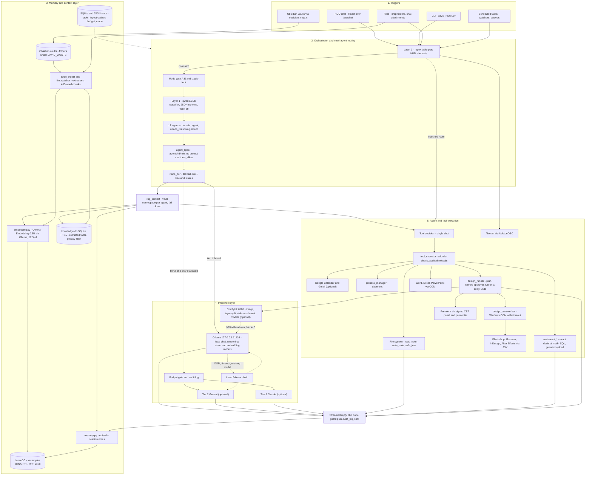

# Architecture

David is a **local-first multi-agent orchestration, retrieval (RAG) and cross-application automation framework**. This file describes the
modules in this repository, how a request flows through them, and how mature each part is.

Maturity scale: **P** production-ready for the single-operator deployment it was built for (used daily, tested) · **WP** working prototype ·
**E** experimental. "P" does not mean multi-tenant or cross-platform: the Adobe/Office bridges are Windows-only, and the core assumes one operator.

## 1. Request flow

**Reading the diagram.**
- The default path is Layer 0 → Layer 1 → agent → retrieval → tool decision → local answer.
- Cloud is reachable only through `route_tier`: a firewalled agent, a DLP match or a missing key forces Tier 1. Tier 2 triggers only on very large input for
  agents that list it; Tier 3 only when `needs_reasoning` is set for agents that list it.
- No tool or agent imports `design_runner.approve`. Approval comes from the Design page's button only.
- Dotted edges are fallbacks or background effects.

## 2. Module inventory

### Orchestration and routing

| Module | Stack | What it does | Maturity |
|---|---|---|---|
| `david_router.py` | Python, Ollama `/api/chat` | CLI entry and the shared routing logic: `LAYER0` regex table → `layer1` classifier (JSON-schema output, `think:false`) → `route_tier` → streaming execution; operating modes A–E; DLP patterns (from `config/vaults.toml`); budget gate; `audit()`; VRAM warm/evict. | P |
| `ollama_config.py` | Python | One source of truth for the Ollama host and a single `num_ctx` per model (a changed `num_ctx` forces a runner reload). | P |
| `agent_spec.py`, `agents/` | Python, Markdown front-matter | Builds each agent's system prompt (`role.md` + shared behaviour + shared safety) and enforces its `tools_allow` list. All 17 agents have a role file. | P |
| `tools.py`, `tool_executor.py` | Python, asyncio | Tool schemas and the async dispatcher; a single-shot tool-decision pass; verbatim tools bypass model rewording; tools outside an agent's allowlist are refused and the refusal is audited. | P |
| `agent_loop.py` | Python | ReAct loop (max 5 iterations). Kept, not on the default HUD path. | WP |
| `code_guard.py` | `ast` | Static validation of model-written Python (syntax, known-bad APIs) plus one repair pass. | WP |
| `process_manager.py` | subprocess | Registry and start/stop of background daemons. | WP |
| `eval_router.py` | Python | Routing evaluation harness: routing cases (≥ 90 % to pass) and DLP cases (all must pass). | WP |

### Memory, retrieval and knowledge

| Module | Stack | What it does | Maturity |
|---|---|---|---|
| `embedding.py` | Ollama `/api/embed`, optional sentence-transformers | Chooses the embedder, table name, cache DB and relevance threshold in one place (`DAVID_EMBEDDER`), so index and query can never disagree. | P |
| `rag.py` | LanceDB, pyarrow | 9-column schema, 400-word chunks with 50 overlap, per-agent vault namespaces (fail closed), vector + BM25 + reciprocal-rank fusion (k = 60), cross-vault fallback, backup/restore with a drop guard. | P |
| `memory.py` | LanceDB via `rag` | Episodic memory: per-turn quotes saved as session notes and recalled on later turns. | WP |
| `knowledge.py` | SQLite FTS5, Ollama | LLM fact extraction into `facts(domain, entity, predicate, value, source)`; a privacy filter hides rows from people tables (nothing is deleted). | P |
| `extractors.py`, `library_rules.py` | pypdf, python-docx/pptx, openpyxl; optional PyMuPDF | Multi-format text extraction that never raises (returns a catalog stub); NFKC normalisation of PDF text; sample-library folders indexed `docs_only`. | P |
| `turbo_ingest.py`, `file_watcher.py`, `rag_watcher.py` | watchdog, Ollama embed, SQLite cache | Batch ingest with a progress file and an "already indexed" cache; incremental watchers. | P (ingest) / WP (watchers) |
| `link_graph.py`, `cross_domain_sweep.py` | NetworkX, LanceDB | Wikilink "bridge note" detection; weekly cross-domain neighbour sweep. | WP |
| `chat_attachments.py` | pypdf, faster-whisper, Pillow | Turns files attached in chat into model context; map-reduce analysis; every limitation is reported as a visible caveat. | P |
| `scripts/` | Python | `run_all_tests.py`, `reembed_table.py` (non-destructive re-embed), `reclaim_lance_versions.py`, restaurant helpers. | WP–P |

### Interfaces

| Module | Stack | What it does | Maturity |
|---|---|---|---|
| `ui/server.py` | FastAPI, uvicorn, WebSockets | The HUD backend: `/ws/chat` runs the full pipeline (Layer 0 → Layer 1 → DLP/tier gate → retrieval → tool decision → stream → code guard → failover). Bound to 127.0.0.1 with a TrustedHost (DNS-rebinding) guard and an Origin guard. | P |
| `ui/frontend/` | React 19, Vite, TypeScript, Tailwind 4, shadcn/Radix | The HUD pages. `npm install && npm run build` (optional: the API starts without a build). | P |
| `ui/restaurant_api.py`, `ui/design_api.py` | FastAPI routers | Thin API layers over the restaurant daily runner and the design runner. | P |
| `obsidian_mcp.js` | Node, Obsidian Local REST API | stdio MCP bridge to the vaults (one port each). The Research vault is excluded unless opted in. | WP |

### Creative-application bridges (the "Design portal", Windows)

| Module | What it does | Maturity |
|---|---|---|
| `design_runner.py` | Job state machine: planned → approved (a named designer + the exact plan fingerprint) → running → done/failed/undone. Runs on copies, verifies the original is unchanged, delivers atomically. | P |
| `design_ops.py`, `design_naming.py`, `design_layer_names.py`, `design_preferences.py` | Operation registry, naming standard, the designer's preference profile (only the designer's own answers can make a value "confirmed"). | P |
| `design_com.py`, `design_handshake.py` | Runs one fixed script in a worker process with a timeout; live connection check of the five Adobe apps. | P |
| `design_photoshop.py`, `design_illustrator.py`, `design_indesign.py`, `design_aftereffects.py`, `design_premiere.py`, `adobe_template_tools.py`, `scripts/*.jsx`, `premiere_cep/` | Per-app fixed operations; a model never writes a script. | P (PS/AI/ID/AE) / WP (Premiere) |
| `design_generate.py`, `design_split.py`, `design_video.py`, `design_music.py`, `design_gpu.py`, `design_pipeline.py`, `comfy_client.py` | Local generation operations on ComfyUI and the chained layered-art pipeline; the GPU is handed over to the job and back. | WP (image, split) / E (video, music) |
| `office_bridge.py`, `adobe_bridge.py`, `generated_tracker.py` | Word/Excel/PowerPoint COM; the older typed-sentence Adobe route is **retired** (returns HTTP 410). | WP / retired |
| `ableton_bridge.py`, `studio_mode.py` | OSC control of Ableton Live and a transport watcher that blocks GPU inference while recording. | WP |

### Vertical example: restaurant operations

| Module | What it does | Maturity |
|---|---|---|
| `restaurant_vision.py` | Reads POS printouts, cash forms and sheet screenshots into schema-forced JSON (vision model, temperature 0, two readings per photo). | P |
| `restaurant_pipeline.py`, `restaurant_day.py` | `prepare` → `finish` → `check` daily runner: vision → menu match → math → draft package + review sheet + questions → `apply.sql`/`undo.sql`. | P |
| `restaurant_tools.py`, `restaurant_weights.py`, `restaurant_corrections.py`, `menu_tools.py` | Exact-decimal cash reconciliation and meat-variance checks (no model does arithmetic), weights workbook reader, correction layer, menu glossary and matcher. | P |
| `restaurant_sql.py`, `restaurant_upload.py` | Generates reviewable SQL; the upload button runs the same file in one transaction and commits only if every check row is found. | P (guarded) |
| `restaurant_watch.py`, `restaurant_shadow.py`, `restaurant_learn.py`, `restaurant_rehearsal.py` | Day-folder watcher, shadow-period scoring, alias learning, SQL rehearsal. | WP |

All names, menus, amounts and identifiers in the restaurant example are **synthetic** ("Demo Bistro"). See `examples/demo_bistro/`.

## 3. Data layout

| Path | What | Created by |
|---|---|---|
| `DAVID_DATA` (default `data/`) | LanceDB index, `knowledge.db`, `tasks.db`, ingest caches, `audit_log.jsonl`, `mode.state`, `budget.json`, generated files, queues | the modules, on first use |
| `DAVID_VAULTS` (default `vaults/`) | one sub-folder per vault (`System`, `Business`, `Music`, `Lore`, `Research`) | you |
| `config/vaults.toml` | vault list, per-agent namespaces, DLP patterns, knowledge-privacy markers | copy of `config/vaults.example.toml` |
| `examples/` | demo vault, demo restaurant tree, demo draft package, demo design scan | this repository |
